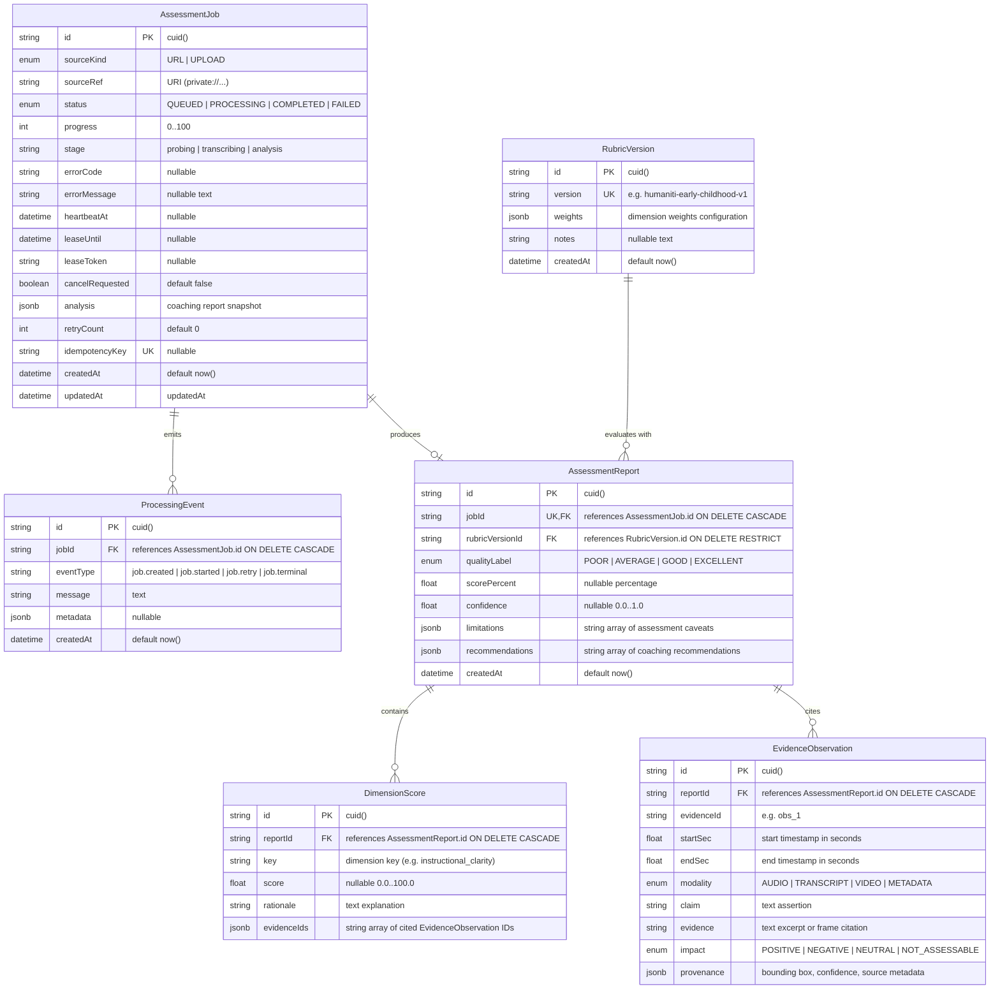
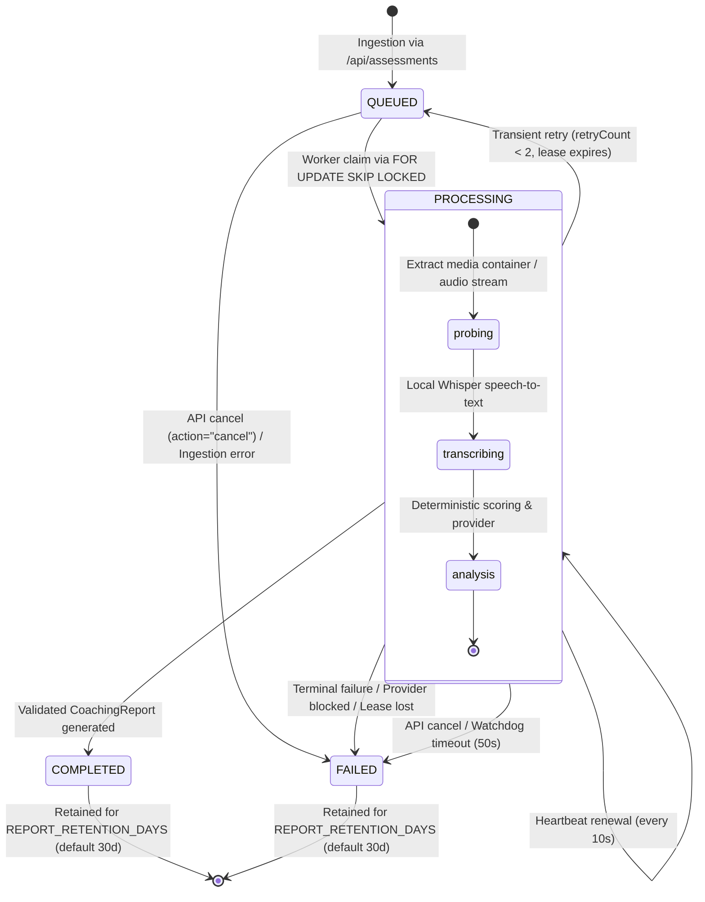

# Data Architecture & Entity-Relationship Model

**Document Version:** 1.1  
**Author / Workstream:** Workstream E — Database Engineer & Data-Lifecycle Reviewer  
**Status:** Verified & Active  
**Database Engine:** PostgreSQL 16  
**ORM / Schema Definition:** Prisma ORM 6.19.3  

---

## 1. Architectural Overview

The Humaniti AI assessment platform stores job states, processing telemetry, versioned rubrics, evaluation reports, dimensional scores, and multimodal evidence in a normalized PostgreSQL schema.

The data model is engineered around four core invariants:
1. **Zero Data Leakage**: Source recordings are ephemeral private media stored exclusively in an untracked local filesystem tree (`.private/`) with owner-only permissions (`0o700`/`0o600`).
2. **Deterministic Foreign Key Cascades**: All telemetry events, reports, dimension scores, and evidence items cascade on job deletion, ensuring clean data eviction upon retention expiration.
3. **Optimized Concurrency & Queuing**: Composite B-tree indexes support atomic job claiming (`FOR UPDATE SKIP LOCKED`), lease timeouts, and deduplication.
4. **Scored Provenance & Grounding**: Every observation links to an explicit source timestamp range, modality, and claim provenance, preventing ungrounded hallucinations.

---

## 2. Entity-Relationship Diagram



---

## 3. Detailed Entity Reference

### 3.1 `AssessmentJob`

Represents an individual video evaluation request, tracking queue position, worker leases, cancellation requests, and cached analysis payloads.

| Field Name | Type | Constraints | Description |
|---|---|---|---|
| `id` | `TEXT` | `PRIMARY KEY` | CUID unique job identifier. |
| `sourceKind` | `SourceKind` (Enum) | `NOT NULL`, Default `'URL'` | Source media intake modality (`'URL'` or `'UPLOAD'`). |
| `sourceRef` | `TEXT` | `NOT NULL` | URI pointing to media asset (e.g., `private://<uuid>.mp4`). |
| `status` | `JobStatus` (Enum) | `NOT NULL`, Default `'QUEUED'` | Current lifecycle state: `QUEUED`, `PROCESSING`, `COMPLETED`, `FAILED`. |
| `progress` | `INTEGER` | `NOT NULL`, Default `0` | Estimated percentage of job completion (`0` to `100`). |
| `stage` | `TEXT` | `NULLABLE` | Granular pipeline stage (`queued`, `probing`, `transcribing`, `analysis`, `completed`, `cancelled`, `expired`). |
| `errorCode` | `TEXT` | `NULLABLE` | Machine-readable failure code (e.g., `provider_blocked`, `processing_expired`, `invalid_media`). |
| `errorMessage` | `TEXT` | `NULLABLE` | Human-readable explanation of error or failure. |
| `heartbeatAt` | `TIMESTAMP(3)` | `NULLABLE` | Timestamp of last worker pulse; renewed every 10 seconds during processing. |
| `leaseUntil` | `TIMESTAMP(3)` | `NULLABLE` | Expiration deadline for active worker lease (typically `NOW() + 60s`). |
| `leaseToken` | `TEXT` | `NULLABLE` | UUID unique token issued to the worker claiming the job. |
| `cancelRequested`| `BOOLEAN` | `NOT NULL`, Default `false` | Asynchronous cancellation flag toggled via API. |
| `analysis` | `JSONB` | `NULLABLE` | Complete validated CoachingReport JSON snapshot for fast API retrieval. |
| `retryCount` | `INTEGER` | `NOT NULL`, Default `0` | Number of times job execution has been retried after transient failure. |
| `idempotencyKey`| `TEXT` | `UNIQUE`, `NULLABLE` | Enforces deduplication across concurrent submissions (e.g., `dataset:<sha256>`). |
| `createdAt` | `TIMESTAMP(3)` | `NOT NULL`, Default `NOW()` | Timestamp when the job record was initially created. |
| `updatedAt` | `TIMESTAMP(3)` | `NOT NULL` | Automatically updated timestamp on every row modification. |

#### Indexes
- `AssessmentJob_pkey`: `PRIMARY KEY (id)`
- `AssessmentJob_idempotencyKey_key`: `UNIQUE (idempotencyKey)`
- `AssessmentJob_status_updatedAt_idx`: `BTREE (status, updatedAt)` — Optimizes status dashboards, historical filtering, and sequential sweeps.
- `AssessmentJob_status_leaseUntil_idx`: `BTREE (status, leaseUntil)` — Added in migration `20261023060000_job_lease_index`. Optimizes worker queue polling queries (`status = 'QUEUED' AND (leaseUntil IS NULL OR leaseUntil <= NOW())`) and sweeper lease reclamation.

---

### 3.2 `ProcessingEvent` (Telemetry / Audit Trail)

Records timestamped audit log events throughout the ingestion, transcribing, probing, evaluation, and completion lifecycle.

| Field Name | Type | Constraints | Description |
|---|---|---|---|
| `id` | `TEXT` | `PRIMARY KEY` | CUID event identifier. |
| `jobId` | `TEXT` | `NOT NULL`, `FK` | References `AssessmentJob.id` with `ON DELETE CASCADE`. |
| `eventType` | `TEXT` | `NOT NULL` | Event category: `job.created`, `job.started`, `job.retry`, `job.terminal`, etc. |
| `message` | `TEXT` | `NOT NULL` | Description of event occurrence. |
| `metadata` | `JSONB` | `NULLABLE` | Structured payload (e.g., stages, durations, resource metrics). |
| `createdAt` | `TIMESTAMP(3)` | `NOT NULL`, Default `NOW()` | Event timestamp. |

#### Indexes & Foreign Keys
- `ProcessingEvent_pkey`: `PRIMARY KEY (id)`
- `ProcessingEvent_jobId_createdAt_idx`: `BTREE (jobId, createdAt)` — Enables efficient chronological event log streaming.
- `ProcessingEvent_jobId_fkey`: `FOREIGN KEY (jobId) REFERENCES AssessmentJob(id) ON UPDATE CASCADE ON DELETE CASCADE`

---

### 3.3 `RubricVersion` (Rubric Definitions)

Maintains versioned evaluation rubrics, dimensions, weights, and scoring policies.

| Field Name | Type | Constraints | Description |
|---|---|---|---|
| `id` | `TEXT` | `PRIMARY KEY` | CUID rubric identifier. |
| `version` | `TEXT` | `UNIQUE`, `NOT NULL` | Version identifier (e.g., `humaniti-early-childhood-v1`). |
| `weights` | `JSONB` | `NOT NULL` | Weight allocations per dimension key (e.g., `{"instructional_clarity": 0.25, ...}`). |
| `notes` | `TEXT` | `NULLABLE` | Documentation regarding rubric rationale and criteria updates. |
| `createdAt` | `TIMESTAMP(3)` | `NOT NULL`, Default `NOW()` | Creation timestamp. |

#### Indexes
- `RubricVersion_pkey`: `PRIMARY KEY (id)`
- `RubricVersion_version_key`: `UNIQUE (version)`

---

### 3.4 `AssessmentReport`

Contains the top-level evaluation outcome, overall score, categorical quality tier, and limitations.

| Field Name | Type | Constraints | Description |
|---|---|---|---|
| `id` | `TEXT` | `PRIMARY KEY` | CUID report identifier. |
| `jobId` | `TEXT` | `UNIQUE`, `NOT NULL`, `FK` | References `AssessmentJob.id` with `ON DELETE CASCADE`. |
| `rubricVersionId`| `TEXT` | `NOT NULL`, `FK` | References `RubricVersion.id` with `ON DELETE RESTRICT`. |
| `qualityLabel` | `QualityLabel` (Enum) | `NOT NULL` | Categorical grade: `POOR`, `AVERAGE`, `GOOD`, `EXCELLENT`. |
| `scorePercent` | `DOUBLE PRECISION` | `NULLABLE` | Weighted score percentage (0.0 to 100.0). |
| `confidence` | `DOUBLE PRECISION` | `NULLABLE` | System confidence metric (0.0 to 1.0). |
| `limitations` | `JSONB` | `NOT NULL` | Array of text caveats and assessment boundaries. |
| `recommendations`| `JSONB` | `NOT NULL` | Array of actionable coaching recommendations. |
| `createdAt` | `TIMESTAMP(3)` | `NOT NULL`, Default `NOW()` | Report generation timestamp. |

#### Indexes & Foreign Keys
- `AssessmentReport_pkey`: `PRIMARY KEY (id)`
- `AssessmentReport_jobId_key`: `UNIQUE (jobId)` — Enforces strict 1:1 relation between job and report.
- `AssessmentReport_jobId_fkey`: `FOREIGN KEY (jobId) REFERENCES AssessmentJob(id) ON UPDATE CASCADE ON DELETE CASCADE`
- `AssessmentReport_rubricVersionId_fkey`: `FOREIGN KEY (rubricVersionId) REFERENCES RubricVersion(id) ON UPDATE CASCADE ON DELETE RESTRICT`

---

### 3.5 `DimensionScore`

Normalized breakdown of scoring for individual pedagogical dimensions.

| Field Name | Type | Constraints | Description |
|---|---|---|---|
| `id` | `TEXT` | `PRIMARY KEY` | CUID dimension score identifier. |
| `reportId` | `TEXT` | `NOT NULL`, `FK` | References `AssessmentReport.id` with `ON DELETE CASCADE`. |
| `key` | `TEXT` | `NOT NULL` | Dimension key (e.g., `instructional_clarity`, `student_engagement`). |
| `score` | `DOUBLE PRECISION` | `NULLABLE` | Dimension score value (or `null` if dimension was marked `not_assessable`). |
| `rationale` | `TEXT` | `NOT NULL` | Grounded explanation for the assigned dimension score. |
| `evidenceIds` | `JSONB` | `NOT NULL` | Array of `EvidenceObservation.evidenceId` cited in this rationale. |

#### Indexes & Foreign Keys
- `DimensionScore_pkey`: `PRIMARY KEY (id)`
- `DimensionScore_reportId_key_key`: `UNIQUE (reportId, key)` — Ensures a report cannot have duplicate scores for the same dimension.
- `DimensionScore_reportId_fkey`: `FOREIGN KEY (reportId) REFERENCES AssessmentReport(id) ON UPDATE CASCADE ON DELETE CASCADE`

---

### 3.6 `EvidenceObservation`

Stores granular, timestamped evidence items supporting the dimension scores and overall coaching evaluation.

| Field Name | Type | Constraints | Description |
|---|---|---|---|
| `id` | `TEXT` | `PRIMARY KEY` | CUID observation identifier. |
| `reportId` | `TEXT` | `NOT NULL`, `FK` | References `AssessmentReport.id` with `ON DELETE CASCADE`. |
| `evidenceId` | `TEXT` | `NOT NULL` | Citation identifier within report scope (e.g., `obs_1`, `obs_2`). |
| `startSec` | `DOUBLE PRECISION` | `NOT NULL` | Start offset in seconds relative to recording start. |
| `endSec` | `DOUBLE PRECISION` | `NOT NULL` | End offset in seconds relative to recording start. |
| `modality` | `EvidenceModality` (Enum) | `NOT NULL` | Media modality: `AUDIO`, `TRANSCRIPT`, `VIDEO`, `METADATA`. |
| `claim` | `TEXT` | `NOT NULL` | Evaluative assertion about observed teacher or student interaction. |
| `evidence` | `TEXT` | `NOT NULL` | Direct quote, transcript excerpt, or visual description. |
| `impact` | `EvidenceImpact` (Enum) | `NOT NULL` | Evaluative polarity: `POSITIVE`, `NEGATIVE`, `NEUTRAL`, `NOT_ASSESSABLE`. |
| `provenance` | `JSONB` | `NOT NULL` | Model confidence, detector metadata, bounding boxes, or Whisper segment references. |

#### Indexes & Foreign Keys
- `EvidenceObservation_pkey`: `PRIMARY KEY (id)`
- `EvidenceObservation_reportId_evidenceId_key`: `UNIQUE (reportId, evidenceId)` — Report-scoped evidence ID uniqueness (allows identical IDs like `obs_1` across distinct reports).
- `EvidenceObservation_reportId_startSec_idx`: `BTREE (reportId, startSec)` — Optimizes chronological evidence timelines.
- `EvidenceObservation_reportId_fkey`: `FOREIGN KEY (reportId) REFERENCES AssessmentReport(id) ON UPDATE CASCADE ON DELETE CASCADE`

---

## 4. Enumerations Reference

```prisma
enum JobStatus {
  QUEUED
  PROCESSING
  COMPLETED
  FAILED
}

enum SourceKind {
  URL
  UPLOAD
}

enum EvidenceModality {
  AUDIO
  TRANSCRIPT
  VIDEO
  METADATA
}

enum EvidenceImpact {
  POSITIVE
  NEGATIVE
  NEUTRAL
  NOT_ASSESSABLE
}

enum QualityLabel {
  POOR
  AVERAGE
  GOOD
  EXCELLENT
}
```

---

## 5. Job Lifecycle State Machine



### 5.1 Concurrency & Lease Protocol
- **Atomic Lease Acquisition**: Worker executes a single transaction with `FOR UPDATE SKIP LOCKED` on `AssessmentJob` where `cancelRequested = false` and `leaseUntil IS NULL OR leaseUntil <= NOW()`.
- **Lease Duration**: Leases are granted for 60 seconds (`NOW() + INTERVAL '60 seconds'`).
- **Heartbeat Loop**: The active worker emits a heartbeat every 10 seconds, advancing `leaseUntil` by another 60 seconds and recording `heartbeatAt = NOW()`.
- **Autonomous Watchdog**: An in-memory timer arms for `LEASE_MS - 10_000` (50s). If database updates hang or network stalls, the worker process group aborts locally, preventing split-brain writes.
- **Cascading Retries**: On non-terminal failure, if `retryCount < MAX_RETRIES` (2), the job is reset to `QUEUED` with exponential backoff (`30s` for retry 1, `120s` for retry 2). If retries are exhausted, status transitions to `FAILED`.

---

## 6. Migration History & Lineage

The database schema evolution is managed through strictly reproducible Prisma migrations:

| Migration Directory | Purpose | Key DDL Changes |
|---|---|---|
| `00000000000000_init` | Baseline database schema | Created all core tables (`AssessmentJob`, `ProcessingEvent`, `RubricVersion`, `AssessmentReport`, `DimensionScore`, `EvidenceObservation`), enums, primary keys, initial indexes, and foreign keys. |
| `20261023050000_assessment_integration` | Worker & caching integration | Added `analysis JSONB`, `cancelRequested BOOLEAN`, and `leaseToken TEXT` to `AssessmentJob`. Changed `AssessmentReport.scorePercent` to `DOUBLE PRECISION`. Dropped global unique index on `EvidenceObservation.evidenceId` in favor of composite unique `(reportId, evidenceId)`. |
| `20261023060000_job_lease_index` | Query & queue performance | Created composite index `AssessmentJob_status_leaseUntil_idx` on `("status", "leaseUntil")` to eliminate sequential scans during worker queue polling and expired lease sweeps. |

---

## 7. Data Integrity & Validation Verification

- **Schema Validation**: Validated via `npm run prisma:validate`.
- **Type Generation**: Verified via `npm run prisma:generate` producing strongly typed TypeScript clients at `@prisma/client`.
- **Migration Status**: Verified via `npx prisma migrate status` against local isolated PostgreSQL on port 55432 (100% up to date, 0 pending migrations).
- **Referential Integrity**: 100% verified using cascade foreign keys on all dependent tables; rubric versions protected via `ON DELETE RESTRICT`.
