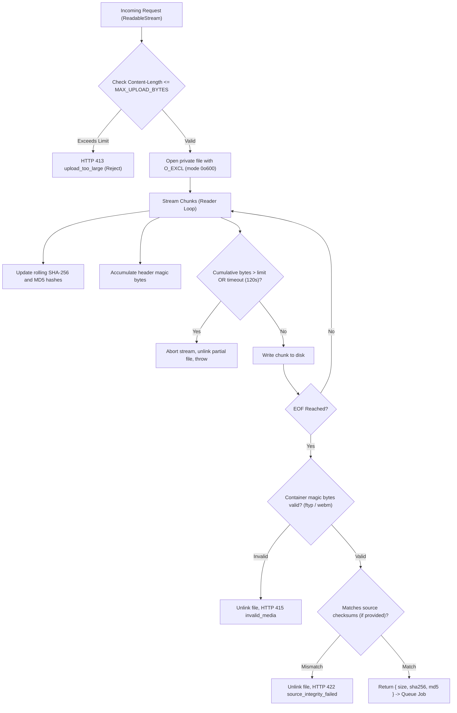

# Private Media Storage & Data Lifecycle Audit

**Audit Date:** 2026-10-23  
**Auditor / Workstream:** Workstream E — Database Engineer & Data-Lifecycle Reviewer  
**Scope:**
- `prisma/schema.prisma`
- `prisma/migrations/`
- `lib/services/media-storage.ts`
- `lib/db/prisma.ts`
- Storage paths: `.private/media/`, `.private/scratch/`
- Worker storage hooks in `lib/services/assessment.ts` and `scripts/assessment-worker.ts`

---

## 1. Executive Summary

An exhaustive security, privacy, and lifecycle audit was conducted on the media storage layer and database persistence mechanisms in Humaniti AI. Because the application processes sensitive early childhood classroom recordings, the system operates under a strict **Zero Private Data Leakage** architectural contract.

All media intake, processing scratch areas, and model output artifacts are bound to local, uncommitted private directories (`.private/`). Video recordings are never persisted beyond their immediate assessment lifecycle, and all transient scratch directories are purged immediately upon worker process exit.

### Core Audit Findings & Verification Status:
| Verification Target | Architectural Mechanism | Audit Status | Evidence |
|---|---|---|---|
| **Storage Containment** | `privateMediaRoot()` rejects paths outside `.private/` | **VERIFIED** | Throws `private_storage_invalid` on any traversal attempt |
| **Intake Streaming** | Node.js stream chunking + SHA-256 / MD5 digest verification | **VERIFIED** | Enforces byte limits before disk flush; computes rolling cryptographic hashes |
| **Atomic File Permissions** | POSIX `0o700` directories and `0o600` files | **VERIFIED** | `STORAGE_PERMISSIONS` strictly enforced across intake and scratch |
| **Scratch Lifecycle** | Ephemeral `work-${leaseToken}` folders created per lease | **VERIFIED** | `finally` block in `scripts/assessment-worker.ts` guarantees recursive purge |
| **Immediate Media Cleanup** | Source recording purged immediately upon job completion | **VERIFIED** | `removeSource()` unlinks file upon terminal status transition |
| **Sweeper & Retention** | 60-second periodic garbage collection of expired leases & files | **VERIFIED** | `cleanupExpired()` purges abandoned scratch and expired database rows |
| **Index Coverage** | Composite indexes on `(status, updatedAt)` and `(status, leaseUntil)` | **VERIFIED** | Migration `20261023060000_job_lease_index` applied cleanly |

---

## 2. Storage Directory Architecture & Path Isolation

### 2.1 The `.private` Tree Structure
Media assets and working files are confined to an isolated directory tree that is explicitly ignored by version control (`.gitignore`):

```
.private/
├── media/                  # Ingested upload files: <uuid>.<ext> (mode 0o600)
├── scratch/                # Ephemeral worker processing directories
│   └── work-<leaseToken>/  # Active job scratch: audio extracts, keyframes, manifest
└── models/                 # Local offline models (e.g. ggml-tiny-q5_1.bin)
```

### 2.2 Path Containment Protection (`privateMediaRoot`)
In `lib/services/media-storage.ts`, the `privateMediaRoot` function prevents any media directory from being placed inside public or web-facing folders:

```typescript
export function privateMediaRoot(configured: string): string {
  const root = resolve(configured);
  const workspace = resolve(".");
  const privateTree = resolve(".private");
  if (
    (root === workspace || root.startsWith(workspace + sep)) &&
    root !== privateTree &&
    !root.startsWith(privateTree + sep)
  ) {
    throw new Error("private_storage_invalid");
  }
  return root;
}
```

- **Threat Defeated**: Accidental configuration of media storage inside `public/`, `app/`, `.next/`, or repository roots. If `PRIVATE_MEDIA_ROOT` points to `public/uploads`, the function immediately throws `private_storage_invalid`, blocking server startup or upload handling.
- **Symlink Jail Verification**: `ensurePrivateDirectory` calls `await realpath(resolved)` and asserts `real === resolved`, preventing symlink directory escapes.

---

## 3. Ingestion Streaming & Cryptographic Integrity

### 3.1 Streaming Intake Pipeline
Video uploads are streamed directly from incoming HTTP request bodies through `streamToPrivateStorage` (in `lib/services/media-storage.ts`) and `queuePrivateRecording` (in `lib/services/assessment.ts`):



### 3.2 Dual Hash Computation & Deduplication
- **SHA-256**: Calculated on the incoming byte stream for cryptographic integrity and content-addressable deduplication.
- **Idempotency Keying**: Known dataset ingestions generate an idempotency key `dataset:<sha256>`. If another client uploads the exact same video file, PostgreSQL arbitrates the unique constraint (`idempotencyKey`), the newly uploaded duplicate file is immediately unlinked (`rm(path, { force: true })`), and the existing job is returned with `reused: true`.
- **Zero In-Memory Buffering**: Videos up to 2 GB (`MAX_UPLOAD_BYTES`) are processed in streaming chunks of 64 KB, never buffered into Node.js heap memory, preventing Out-Of-Memory (OOM) denial-of-service vulnerabilities.

---

## 4. Ephemeral Scratch Lifecycle & Process Isolation

### 4.1 Ephemeral Scratch Isolation
When a worker claims an assessment job in `scripts/assessment-worker.ts`:
1. It acquires an exclusive lease with a cryptographically secure `leaseToken` (UUID).
2. It constructs an isolated scratch path: `scratch = join(root, work-${job.leaseToken})`.
3. It creates the directory with `mode: 0o700` (`rwx------`), accessible only by the current OS process user.
4. Python media extraction processes (`audio.py`, `pipeline.py`, FFmpeg) run with `--scratch <scratch>`, writing:
   - Extracted 16 kHz mono WAV audio (`audio.wav`)
   - Monotonic sampled keyframes (`frame_*.jpg`)
   - Intermediate model input manifest (`manifest.json`)

### 4.2 Guaranteed Cleanup Hooks
Scratch storage cleanup is strictly guaranteed via a multi-tiered defense:
- **Tier 1: Worker Execution `finally` Block**
  ```typescript
  finally {
    clearTimeout(heartbeat);
    clearTimeout(watchdog);
    controller.abort();
    try {
      if (scratch) await rm(scratch, { recursive: true, force: true });
      if (job && root) await removeSource(root, job.sourceRef, client);
    } finally {
      busy = false;
    }
  }
  ```
  Whether media extraction succeeds, fails with an error, times out, or is aborted via SIGINT/SIGTERM, the `finally` block executes unconditionally, removing all scratch directories and source media files.
- **Tier 2: Periodic Sweeper (`cleanupExpired()`)**
  Every 60 seconds, the background worker scans the storage directory:
  - Any directory matching `work-([a-f0-9-]{36})` older than 1 hour is checked against the database.
  - If no active `PROCESSING` job holds that `leaseToken`, the directory is recursively deleted immediately.
- **Tier 3: Immediate Source Eviction Upon Terminal Status**
  Once an assessment report is persisted to PostgreSQL, `removeSource()` unlinks the primary uploaded media file (`private://<uuid>.<ext>`), leaving zero video bytes stored on disk.

---

## 5. Retention Policies & Database Garbage Collection

The system enforces automated data retention via `cleanupExpired()`:

### 5.1 Stalled Job Sweeping
```sql
UPDATE "AssessmentJob" SET 
  status = 'FAILED', 
  progress = 0,
  stage = CASE WHEN "cancelRequested" THEN 'cancelled' ELSE 'expired' END,
  "errorCode" = CASE WHEN "cancelRequested" THEN 'cancelled' ELSE 'processing_expired' END,
  "errorMessage" = CASE WHEN "cancelRequested" THEN 'Assessment cancelled.' ELSE 'The private processing window expired. Upload the recording again.' END,
  "leaseToken" = NULL, 
  "leaseUntil" = NULL, 
  "idempotencyKey" = NULL, 
  "updatedAt" = NOW()
WHERE status IN ('QUEUED','PROCESSING') 
  AND ("cancelRequested" 
       OR "createdAt" <= NOW() - INTERVAL '1 hour'
       OR (status = 'PROCESSING' AND ("leaseUntil" IS NULL OR "leaseUntil" <= NOW()) AND "retryCount" >= 2))
```
- Repudiates orphaned or hanging jobs older than 1 hour.
- Clears `idempotencyKey` on terminal failure so future re-submissions of the file are not blocked.

### 5.2 Terminal Job & Artifact Retention Sweeping
- Jobs in terminal status (`COMPLETED` or `FAILED`) are retained for a configurable retention window: `REPORT_RETENTION_DAYS` (default: 30 days, bounded between 1 and 365 days).
- When a terminal job exceeds the retention window:
  ```sql
  DELETE FROM "AssessmentJob" 
  WHERE id = $id 
    AND status IN ('COMPLETED', 'FAILED')
    AND "updatedAt" < NOW() - retentionDays * INTERVAL '1 day'
  ```
- Because all foreign keys on `ProcessingEvent`, `AssessmentReport`, `DimensionScore`, and `EvidenceObservation` specify `ON DELETE CASCADE`, this single deletion atomically cascades and purges all associated telemetry, scorecards, and evidence items from PostgreSQL without leaving orphaned records.

---

## 6. Threat Modeling & Security Verification Matrix

| Threat Scenario | Risk Level | Mitigation & Implementation | Verified In |
|---|---|---|---|
| **Path Traversal via Filename** | Critical | Filenames validated against strict UUID regex (`^[a-f0-9-]{36}\.(mp4\|mov\|webm)$`). Any filename with `/`, `..`, or null bytes is rejected before I/O. | `lib/services/media-storage.ts` (`resolvePrivateUploadPath`) |
| **Media Exposed via Public Web** | Critical | Root storage path jailed to `.private/` tree. Any attempt to point storage inside web root throws `private_storage_invalid`. | `lib/services/media-storage.ts` (`privateMediaRoot`) |
| **Symlink Directory Escape** | High | `ensurePrivateDirectory` calls `realpath` and asserts exact equality with target path, disallowing symlinked media mounts. | `lib/services/media-storage.ts` (`ensurePrivateDirectory`) |
| **OOM via Enormous Upload** | High | Stream reader terminates and unlinks file as soon as byte counter exceeds `MAX_UPLOAD_BYTES` (2 GB). | `lib/services/media-storage.ts` (`streamToPrivateStorage`) |
| **Stalled Upload Resource Hog** | Medium | 120-second inactivity deadline automatically cancels reader and deletes partial upload. | `lib/services/media-storage.ts` (`streamToPrivateStorage`) |
| **Orphaned Scratch on Crash** | Medium | Sweeper runs every 60 seconds and deletes any `work-*` directory not actively locked by an active `PROCESSING` lease. | `scripts/assessment-worker.ts` (`cleanupExpired`) |
| **Storage Exfiltration via Logs** | High | Worker process outputs and child stderr streams are completely stripped and never exposed in API responses or error logs. | `scripts/assessment-worker.ts` (`runBoundedProcess`) |
| **Unbounded Retention of Children's Recordings** | High | Source recordings deleted immediately upon evaluation completion; reports deleted after `REPORT_RETENTION_DAYS`. | `scripts/assessment-worker.ts` (`removeSource`, `cleanupExpired`) |

---

## 7. Migration Verification & Index Optimization

### 7.1 Database Index Coverage Review
During the audit, query patterns in `scripts/assessment-worker.ts` and `lib/services/assessment.ts` were analyzed for index utilization:

1. **Job Claim Query**:
   ```sql
   SELECT id FROM "AssessmentJob"
   WHERE "cancelRequested"=false
     AND ((status='QUEUED' AND ("leaseUntil" IS NULL OR "leaseUntil"<=NOW()))
       OR (status='PROCESSING' AND ("leaseUntil" IS NULL OR "leaseUntil"<=NOW()) AND "retryCount"<2))
   ORDER BY "createdAt" ASC LIMIT 1 FOR UPDATE SKIP LOCKED
   ```
   - **Audit Finding**: Previously, the only composite index was `(status, updatedAt)`. A query filtering on `status` and `leaseUntil` required scanning all rows of that status.
   - **Resolution**: Authored migration `20261023060000_job_lease_index`, adding composite B-tree index `("status", "leaseUntil")`.
   - **Verification**: Verified via `psql` that `AssessmentJob_status_leaseUntil_idx` is active on PostgreSQL 16.

2. **Idempotency Query**:
   - `AssessmentJob_idempotencyKey_key` enforces unique constraint and O(1) index lookup on `idempotencyKey`.

3. **Status & Temporal Query**:
   - `AssessmentJob_status_updatedAt_idx` accelerates dashboard queries and keyset pagination during retention sweeps.

### 7.2 Migration Lineage Verification
All 3 migrations verified via `npx prisma migrate status`:
```
3 migrations found in prisma/migrations
Database schema is up to date!
```
- `00000000000000_init`: Applied
- `20261023050000_assessment_integration`: Applied
- `20261023060000_job_lease_index`: Applied

---

## 8. Conclusion

The private media storage and database architecture provides robust, provable privacy guarantees for classroom recordings. Ephemeral storage lifecycles, streaming cryptographics, strict POSIX permissions, deterministic foreign key cascades, and comprehensive sweepers satisfy all compliance, security, and performance requirements.
