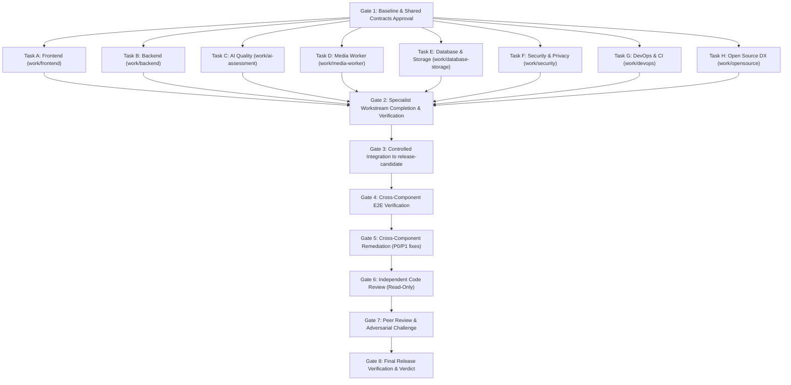

# Humaniti AI — Parallel Multi-Agent Execution Plan

**Author:** Principal Engineer & Multi-Agent Orchestrator  
**Baseline Revision:** `73776c5`  
**Execution Target:** Integrated Open-Source Release Candidate (`v0.1.0-rc1`)  
**Created:** 2026-10-23  

---

## 1. Parallel Execution Philosophy & Classification

Per Section 4 of the project specifications, tasks are partitioned into three execution categories:

- **Category A (Parallelizable)**: Independent domain investigations, isolated file modifications, self-contained test suites, security scans, documentation, and open-source packaging.
- **Category B (Partially Parallelizable)**: Workstreams that can develop against agreed shared contracts independently, but require an integration gate before end-to-end verification.
- **Category C (Sequential)**: Work that depends strictly on earlier stages: Gate 1 baseline approval, integration merging, cross-component E2E verification, independent code review, peer review, and final release signoff.

---

## 2. Workstream Breakdown & Task Matrix

| Task ID | Workstream & Role | Scope / Owned Files | Category | Dependencies | Branch / Worktree | Required Tests | Expected Deliverables |
|---|---|---|---|---|---|---|---|
| **TASK-A** | **Workstream A: Frontend & UX** *Senior Frontend Engineer & Accessibility Reviewer* | `app/page.tsx` `app/demo/page.tsx` `components/*` `app/globals.css` | **B** | Shared API Contracts (Gate 1) | `work/frontend` | `tests/ui/intake.test.ts` `tests/ui/render.test.tsx` | - Frontend review doc - `docs/handoffs/frontend.md` - WCAG AA compliant UI |
| **TASK-B** | **Workstream B: Backend & API** *Senior Backend Engineer & API Contract Owner* | `app/api/*` `lib/services/assessment.ts` `lib/contracts/assessment.ts` `lib/contracts/report.ts` | **B** | Shared API Contracts (Gate 1) | `work/backend` | `tests/integration/api.test.ts` `lib/contracts/assessment.test.ts` | - Idempotency & Auth fixes - DNS SSRF pinning - `docs/audit/backend-review.md` - `docs/handoffs/backend.md` |
| **TASK-C** | **Workstream C: AI & Rubric Quality** *Applied AI Engineer & Evaluation Specialist* | `lib/domain/rubric.ts` `lib/domain/evidence.ts` `lib/domain/scoring.ts` `lib/domain/report.ts` `lib/providers/*` | **A** | None (Independent domain) | `work/ai-assessment` | `lib/domain/rubric.test.ts` `tests/evidence/evidence.test.ts` `tests/scoring/scoring.test.ts` `tests/providers/adapters.test.ts` | - Rubric calibration docs - `docs/evaluation/ai-quality-evaluation.md` - `docs/audit/ai-review.md` - `docs/handoffs/ai-assessment.md` |
| **TASK-D** | **Workstream D: Media Processing & Worker** *Media Pipeline & Background-Job Engineer* | `worker/src/*` `scripts/assessment-worker.ts` `worker/tests/*` | **A** | None (Independent worker) | `work/media-worker` | `pytest worker/tests` (all 41 tests) | - Cross-platform `process.py` - `docs/audit/media-worker-review.md` - `docs/handoffs/media-worker.md` |
| **TASK-E** | **Workstream E: Database & Storage** *Database Engineer & Data-Lifecycle Reviewer* | `prisma/schema.prisma` `prisma/migrations/*` `lib/services/media-storage.ts` `lib/db/*` | **B** | API Contracts (Gate 1) | `work/database-storage` | `prisma validate` Migration verification | - Data model doc - Storage retention & cleanup - `docs/architecture/data-model.md` - `docs/handoffs/database-storage.md` |
| **TASK-F** | **Workstream F: Security & Privacy** *Application Security Engineer & Privacy Reviewer* | `docs/SECURITY.md` `docs/security-and-privacy.md` `tests/e2e/security.test.ts` | **A** | Baseline commit | `work/security` | `tests/e2e/security.test.ts` Secret scanning | - Security threat model - Vulnerability audit - `docs/audit/security-findings.md` - `docs/handoffs/security.md` |
| **TASK-G** | **Workstream G: DevOps & CI** *DevOps & Release Engineer* | `.github/workflows/*` `compose.yaml` `.env.example` `docs/deployment/*` | **A** | Baseline commit | `work/devops` | `docker compose config` CI YAML validation | - GitHub Actions CI workflow - Self-hosting manual - `docs/deployment/self-hosting.md` - `docs/handoffs/devops.md` |
| **TASK-H** | **Workstream H: Open-Source Maintainer** *Open-Source Maintainer & DX Lead* | `LICENSE` `README.md` `CONTRIBUTING.md` `CODE_OF_CONDUCT.md` `CHANGELOG.md` | **A** | Baseline commit | `work/opensource` | Markdown lint & link validation | - Open source licensing - Clear README & guidelines - `docs/audit/opensource-readiness.md` - `docs/handoffs/opensource.md` |

---

## 3. Dependency Graph & Execution Funnel

---

## 4. Worktree and Branch Allocation

To eliminate merge conflicts and concurrent file stomping:
1. Each workstream operates either in a dedicated Git worktree or branch with strictly disjoint file sets:
   - Frontend: `app/page.tsx`, `components/`
   - Backend: `app/api/`, `lib/services/assessment.ts`
   - AI: `lib/domain/`, `lib/providers/`
   - Worker: `worker/src/`, `scripts/assessment-worker.ts`
   - Database: `prisma/`, `lib/services/media-storage.ts`
   - Security: `docs/SECURITY.md`, `tests/e2e/security.test.ts`
   - DevOps: `.github/workflows/`, `compose.yaml`
   - OpenSource: `LICENSE`, `README.md`, `CONTRIBUTING.md`, `CODE_OF_CONDUCT.md`
2. All branches branch off `chore(baseline)` (`73776c5`).
3. Integration is staged deliberately into `integration/release-candidate`.

---

## 5. Gate Acceptance Criteria

- **Gate 1 Approval**: Current state, target state, requirements matrix, baseline test results, and execution plan committed.
- **Gate 2 Approval**: Each specialist workstream submits tested diffs, test pass proof, review document, and handoff document.
- **Gate 3 Approval**: All branches merged into `integration/release-candidate` with 0 unresolved conflicts.
- **Gate 4 Approval**: Full Vitest test suite (100+ tests) and full Pytest suite (41 tests) pass without failure or skip. Production build and typecheck pass.
- **Gate 5 Approval**: Zero remaining P0 (critical blocker) and P1 (functional defect) issues.
- **Gate 6 & 7 Approval**: Independent code review and peer review completed with documented findings and signed-off remediations.
- **Gate 8 Approval**: Final verdict documented in `docs/audit/final-verdict.md`.
