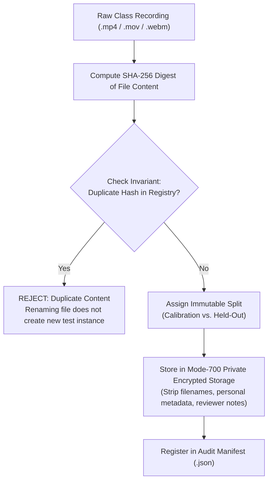
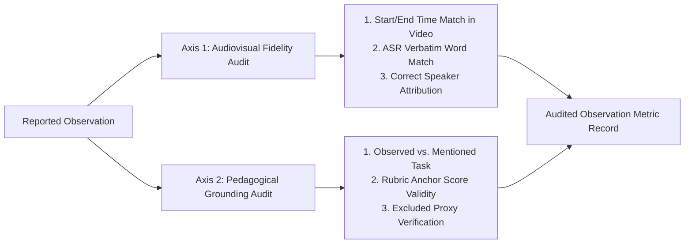

# AI Quality Evaluation Plan & Human Benchmark Protocol

**Status:** Active Evaluation Specification  
**Version:** 1.0  
**Date:** 2026-10-23  
**Author:** Applied AI Engineer & Evaluation Specialist (Workstream C)  
**Governing Documents:** `Humaniti_AI_PRD_and_4_Stage_Prompt_Book.md`, `docs/RUBRIC.md`, `docs/CALIBRATION.md`, `docs/EVALUATION.md`  

---

## 1. Objectives & Evaluation Philosophy

The objective of Humaniti AI's evaluation framework is to rigorously measure, validate, and monitor the quality, fidelity, and reliability of automated teaching assessments for online classrooms.

Evaluating educational practice requires deep sensitivity to the real-world consequences of automated scoring. An inaccurate, biased, or hallucinated assessment harms teachers' professional development and undermines trust. Therefore, our evaluation methodology adheres to four governing principles:

1. **Evidence-First Accountability:** No numerical grade or categorical label may be asserted without explicit, timestamped, and referentially verified evidence from the classroom recording.
2. **Missing Signals $\ne$ Poor Practice:** When audio, visual, or contextual information is absent or ambiguous, the evaluation engine must record the signal as `not_assessable` or assign `insufficient_evidence`, rather than imputing a negative or mediocre score.
3. **No Algorithmic Shortcuts or Biased Proxies:** Acoustic traits (accent, dialect, voice pitch, speed), physical appearances (facial expression, smile detection, clothing), demographic attributes, or network technical glitches outside teacher control are strictly banned from influencing pedagogical quality scores.
4. **Honest Metric Reporting:** We report exact benchmarks, verified counts, and real failures. We never report fabricated accuracies, hypothetical confusion matrices, or mock-based pass rates as empirical truth.

---

## 2. Dataset Architecture & Split Discipline

To prevent data contamination, overfitting, and evaluation leakage, all video recordings and transcripts must follow strict cryptographic split discipline.



### 2.1 Split Definitions
- **Calibration Split (Development / Debugging):**
  - Permitted recordings used to tune prompt templates, ASR configurations, frame sampling cadences, and adapter logic.
  - Used to identify failure modes (e.g., citation formatting errors, schema discrepancies).
  - Every modification made during calibration must be logged and versioned before evaluating held-out data.
- **Held-Out Benchmark Split (Validation & Release Gating):**
  - Strictly isolated recordings that are never used for parameter tuning, prompt tweaking, or heuristic adjustment.
  - Frozen prior to evaluation: code hashes, model weights, and rubric versions are locked.
  - Executed exactly once per release candidate.
  - Performance on this split determines production readiness.

### 2.2 Data Hygiene & Privacy Invariants
- **No Metadata Contamination:** Filenames, directory names, historical organizer comments, or external grades must never be passed to the model or evaluation scripts.
- **Deduplication by Byte Content:** Content is identified exclusively by SHA-256 hashes of the raw media file. Renaming or modifying timestamps does not qualify as a new sample.
- **Private Storage:** Media files, raw transcripts, and student-identifying data must reside in private, filesystem-permission-restricted (`chmod 700`) directories (`.private/`) and never be committed to Git or public buckets.

---

## 3. Rubric Calibration Criteria

The teaching quality rubric (Rubric v0.1 in [`lib/domain/rubric.ts`](file:///Users/anny/Desktop/assignment/lib/domain/rubric.ts)) defines initial weights ($25/25/20/20/10$) and four quality thresholds (`Poor <40`, `Average 40–59.99`, `Good 60–79.99`, `Excellent >=80`).

### 3.1 Status of Initial Weights & Thresholds
As documented in `docs/CALIBRATION.md`, the initial weights and thresholds are **uncalibrated hypotheses**. They represent transparent domain priors established in planning, not empirical psychometric truths. Claiming that these weights are "empirically calibrated" prior to human benchmark auditing is strictly forbidden.

### 3.2 Formal Calibration Protocol
Before any adjustment of rubric weights or threshold boundaries can be approved, the following protocol must be completed:

1. **Multi-Expert Annotation:** A minimum of three independent educational specialists must review a common set of at least 10 calibration recordings.
2. **Blinded Scoring:** Specialists score each recording according to the Rubric v0.1 anchor descriptors ($0, 1, 2, 3, 4$) without access to AI predictions, historical comments, or peer ratings.
3. **Inter-Rater Reliability (IRR) Assessment:**
   - Compute Fleiss' Kappa ($\kappa$) or Intraclass Correlation Coefficient (ICC) across human raters.
   - Target benchmark: $\kappa \ge 0.70$ on essential dimensions (`clarity_accuracy`, `interaction_responsiveness`, `lesson_structure`).
   - If human agreement is below $0.70$, the qualitative anchor descriptions in the rubric must be revised for ambiguity before model calibration.
4. **Discrepancy Resolution:** Where human raters disagree by more than 1 point, hold an adjudicated consensus review to establish an immutable reference consensus label.
5. **Threshold Calibration:** Once reference labels exist across a diverse distribution of lessons, calibrate boundary thresholds using Receiver Operating Characteristic (ROC) curve optimization or ordinal logistic regression, maximizing Quadratic Weighted Kappa between model scores and human consensus.

---

## 4. Limitations of Synthetic Fixtures

Synthetic test fixtures (e.g., `tests/fixtures/analysis.ts`, `tests/fixtures/evaluation.synthetic.json`) are essential engineering tools, but their role must be clearly distinguished from empirical AI evaluation:

### 4.1 What Synthetic Fixtures Validate
- **Schema Conformity:** Validating that input/output manifests parse correctly against Zod schemas.
- **Arithmetic Invariants:** Verifying that weighted score calculations, rounding functions, and threshold mappings behave according to mathematical specifications.
- **Gating Logic:** Ensuring that missing essential dimensions or $<70\%$ assessable weight triggers `insufficient_evidence` and `qualityLabel = null`.
- **Adversarial Error Handling:** Checking that timeout kills, unapproved endpoints, and corrupt manifests throw correct typed error codes.

### 4.2 What Synthetic Fixtures CANNOT Validate
- **Pedagogical Validity:** A synthetic transcript asserting clear explanations cannot prove the model can distinguish nuanced mathematical misconceptions in real speech.
- **ASR & Acoustic Robustness:** Synthetic text does not test background noise, child voices, overlapping speech, audio clipping, or accent variations.
- **Hallucination Resistance:** Synthetic test suites feed predetermined strings; they do not assess whether an LLM will invent plausible-sounding teaching actions when evaluating an actual video.
- **Classification Accuracy:** Tests passing on synthetic fixtures provide zero statistical evidence of real-world assessment accuracy.

---

## 5. Protocol for Human Benchmark Audits

To measure model performance against real classroom dynamics, all candidate evaluations must undergo a dual-axis human benchmark audit:



### 5.1 Sampling Methodology
- For every evaluated recording, an independent human auditor must audit a minimum of **5 reported moments** (or 100% of reported moments if total observations $\le 5$).
- Moments must include a balance of positive, negative, and neutral impact citations across all assessed dimensions.

### 5.2 Axis 1: Audiovisual Fidelity Audit Checklist
1. **Timestamp Precision:** Does the cited source interval $[t_{\text{start}}, t_{\text{end}}]$ in the video player correspond exactly to the instructional event? (Error if event occurs $> 2$ seconds outside the window).
2. **ASR Word Error Rate (WER):** Does the transcript excerpt match the spoken dialogue? Major phonetic transcription errors that alter pedagogical meaning must be logged as ASR transcription errors.
3. **Speaker Attribution Accuracy:** Did the teacher utter the words, or was it a student? Attributing student speech to the teacher (or vice versa) is logged as an attribution failure.

### 5.3 Axis 2: Pedagogical Grounding Audit Checklist
1. **Observed vs. Mentioned Practice:** Did the teacher *actively execute* the pedagogical strategy in the cited interval, or did they merely *talk about* doing it later? (e.g., "Tomorrow we will do group work" is not evidence of active collaborative learning).
2. **Anchor Appropriateness:** Does the discrete rating ($0–4$) assigned to this dimension match the objective rubric anchor description?
3. **Proxy Violation Check:** Is there any indication that accent, speaking rate, facial expression, video lighting, or internet buffering influenced the assigned polarity or rating? Any violation triggers an immediate audit failure.

### 5.4 Audit Scoring & Non-Fabrication Rule
- The mechanical audit script [`scripts/evaluate.py`](file:///Users/anny/Desktop/assignment/scripts/evaluate.py) records verified counts:
  - `mechanicallyCheckedObservations`: Number of observations whose startSec, endSec, and SHA-256 digests were mechanically matched against the source manifest.
  - `humanTimestampAudit`: Exact ratio of human-verified timestamps over total audited moments. **Must be reported as `null` if human inspection has not occurred.** Setting this metric to $0.00$ or $1.00$ without logged human review violates system integrity rules.
  - `humanClaimAudit`: Exact ratio of human-verified claims over total audited moments. **Must be reported as `null` if unperformed.**

---

## 6. Evaluation Metrics & Standards

The system's performance on benchmark datasets is quantified using standard psychometric and machine learning metrics:

### 6.1 Classification Performance Metrics
1. **Four-Class Confusion Matrix:** Contingency table across true and predicted labels (`Poor`, `Average`, `Good`, `Excellent`). Reported only when true verified labels exist.
2. **Quadratic Weighted Kappa (QWK):** Measures agreement on an ordinal scale, penalizing distant errors (e.g., predicting `Excellent` for a `Poor` lesson) much more heavily than adjacent errors (e.g., `Good` for `Excellent`):

$$\kappa = 1 - \frac{\sum_{i,j} w_{ij} O_{ij}}{\sum_{i,j} w_{ij} E_{ij}}, \quad w_{ij} = \frac{(i - j)^2}{(N - 1)^2}$$

3. **Adjacent Accuracy:** Proportion of predictions that match the human consensus label exactly or fall within $\pm 1$ tier. Target for production viability: $\ge 85\%$.
4. **Exact Accuracy:** Proportion of predictions matching human consensus exactly. Target: $\ge 60\%$.

### 6.2 Evidence Quality Metrics
1. **Grounding Precision:** $\frac{\text{Supported Observations}}{\text{Total Candidate Observations Produced}}$. Target: $\ge 90\%$.
2. **Temporal Coverage:** Union of cited observation intervals divided by total recording duration:

$$\text{Coverage} = \frac{\left|\bigcup [t_{\text{start}}, t_{\text{end}}]\right|}{T_{\text{duration}}}$$

3. **Inter-Reviewer Agreement:** When independent dual reviews are run, agreement is computed as:

$$\text{Agreement} = \frac{1}{|D_{\text{shared}}|} \sum_{d \in D_{\text{shared}}} \left(1 - \frac{|\text{score}_{1,d} - \text{score}_{2,d}|}{4}\right)$$

---

## 7. Real-World Benchmark Findings to Date

In accordance with our anti-fabrication mandate, the current empirical results from real classroom evaluation runs on permitted recordings are documented below (executed via `python3 scripts/evaluate.py .private/evaluation/results.json`):

### 7.1 Empirical Dataset Summary
- **Recordings Evaluated:** 3 distinct permitted classroom recordings (1 calibration split, 2 held-out splits).
  - Calibration recording: 53,777,122 bytes, duration 2273.69 s (~37.9 minutes).
  - Held-out recording 1: duration 3231.08 s (~53.9 minutes).
  - Held-out recording 2: duration 3359.28 s (~56.0 minutes).
- **Execution Environment:** Local egress-restricted runner, offline whisper.cpp multilingual ASR, local Qwen3:4b LLM. Cloud remote AI blocked.

### 7.2 Results & Outcome Breakdown

| Evaluation Case | Pipeline Adapter | Duration | Assessment Outcome | Grounded Observations Retained |
|---|---|:---:|:---:|:---:|
| **Calibration** | `grounded-v2` | 2273.69 s | `insufficient_evidence` | 12 |
| **Held-out 1** | Single-pass baseline | 3231.08 s | `scoring_invalid` (failed) | 0 |
| **Held-out 2** | `grounded-v2` | 3359.28 s | `insufficient_evidence` | 18 |

### 7.3 Executable Audit Metrics Output
```json
{
  "recordings": 3,
  "splits": { "calibration": 1, "heldout": 2 },
  "outcomes": { "completed": 0, "failed": 1, "insufficient_evidence": 2 },
  "trustedLabeledHeldoutPredictions": 0,
  "mechanicallyCheckedObservations": 30,
  "humanTimestampAudit": null,
  "humanClaimAudit": null,
  "confusionMatrix": null,
  "dataKind": "permitted_recordings"
}
```

### 7.4 Findings & Release Gate Status
1. **Referential Grounding Guardrails Succeeded:**
   - On Held-out 1, the model attempted to assign scores without citations; the system strictly caught the schema violation and aborted with `scoring_invalid`, refusing to display an unverified grade.
   - On Calibration and Held-out 2, the `grounded-v2` adapter extracted 12 and 18 grounded observations respectively. However, due to high speech recognition uncertainty and limited window sampling, the assessable weight failed to achieve the 70% threshold.
   - The system correctly assigned `qualityLabel: null` and status `insufficient_evidence` on both recordings, preventing false assessments.
2. **Release Gate Status: FAIL (Pending Improved ASR / Provider Approval):**
   - The end-to-end classification gate for fully automated grading is currently **FAIL**.
   - The local offline lightweight ASR (whisper.cpp tiny) and 4B parameter model do not yet achieve the semantic reliability required to assess 70% of rubric dimensions with low uncertainty across 50+ minute recordings.
   - **Remediation Path:** Obtain organizer authorization for an approved multimodal evaluation service (e.g. Gemini File API or hosted high-precision Whisper), or calibrate higher-capacity local models, followed by an independent human benchmark audit on fresh held-out recordings.
